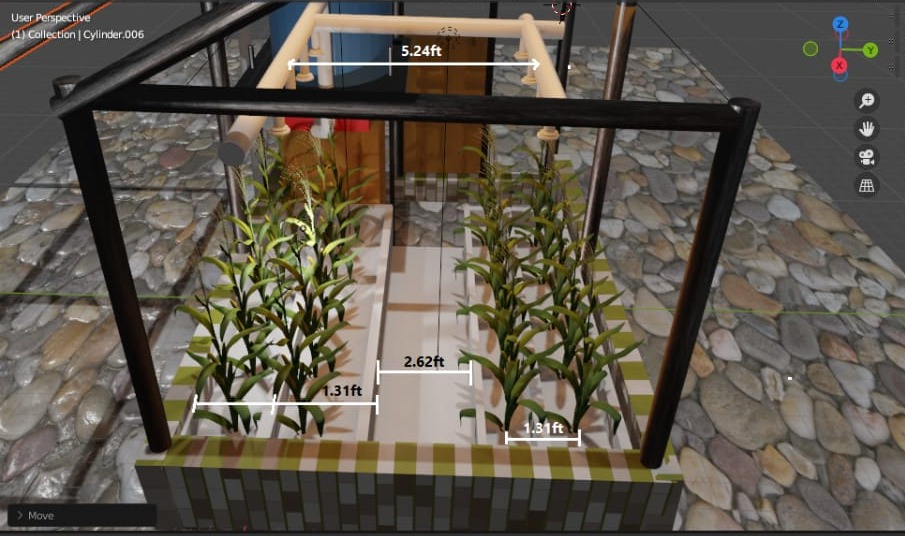
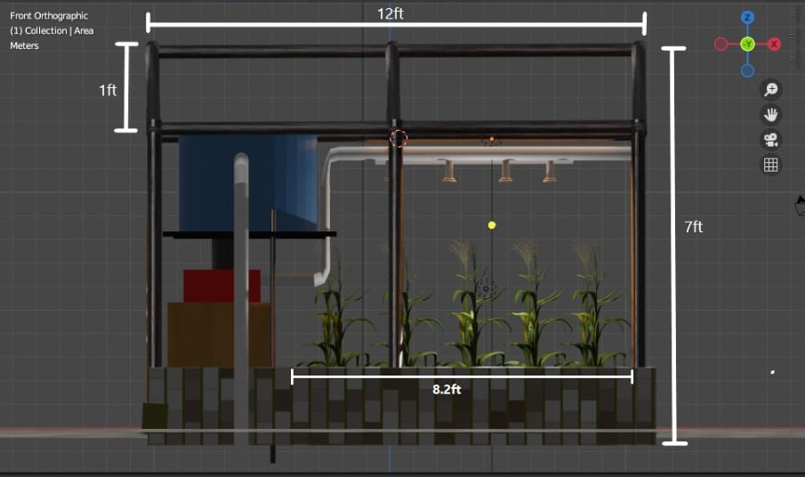
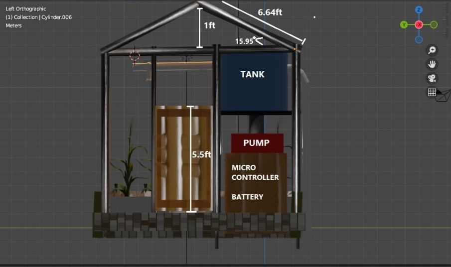
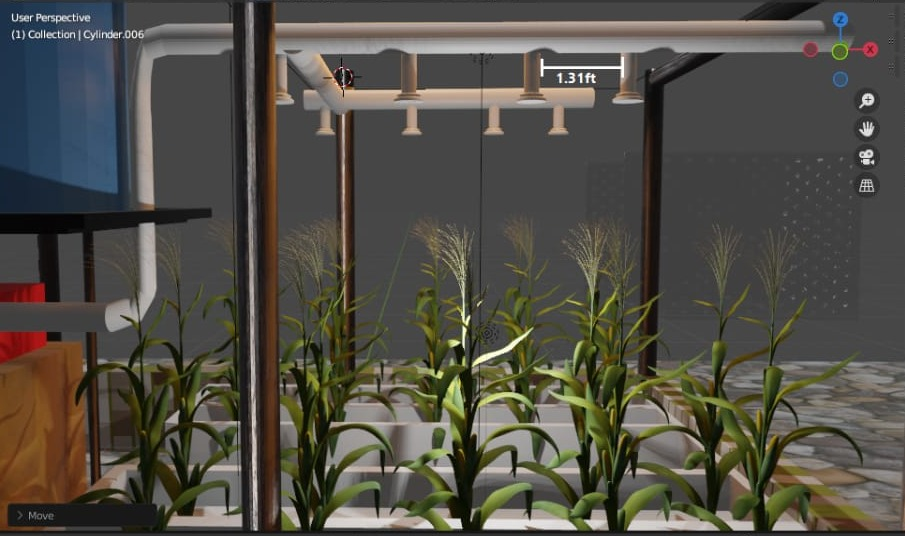
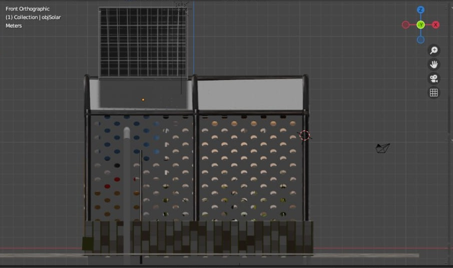
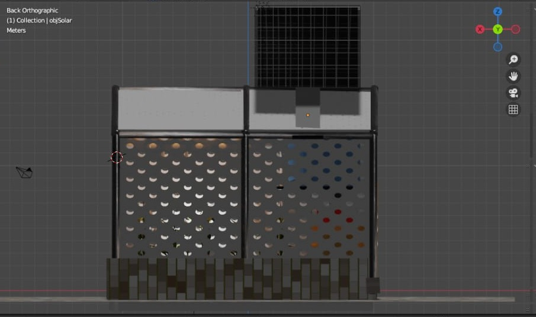
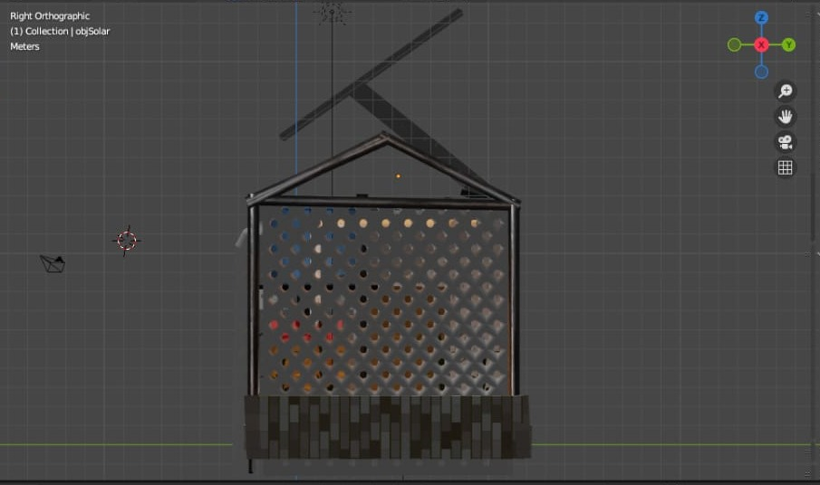
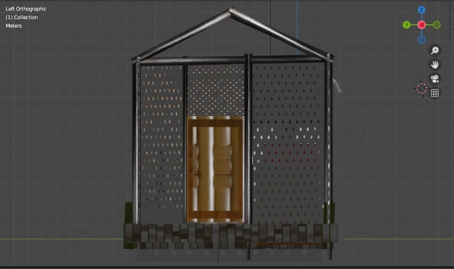
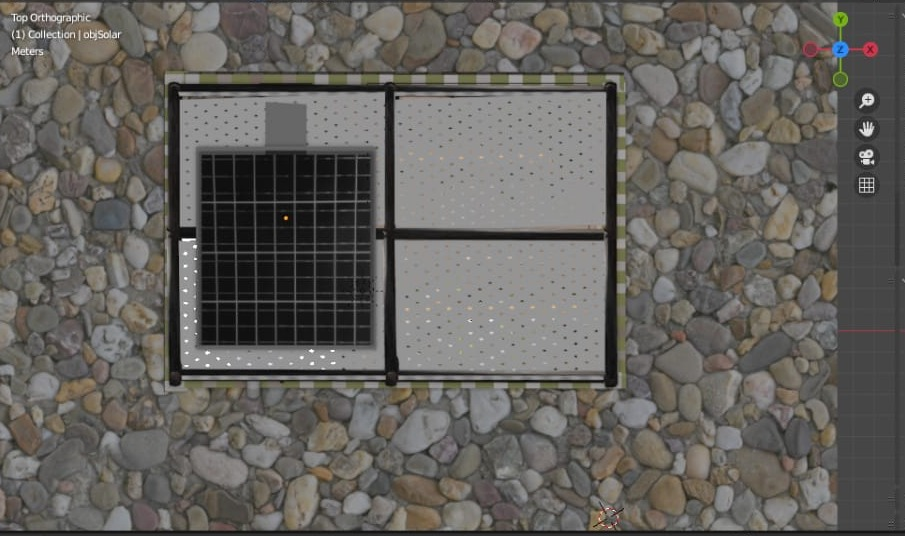
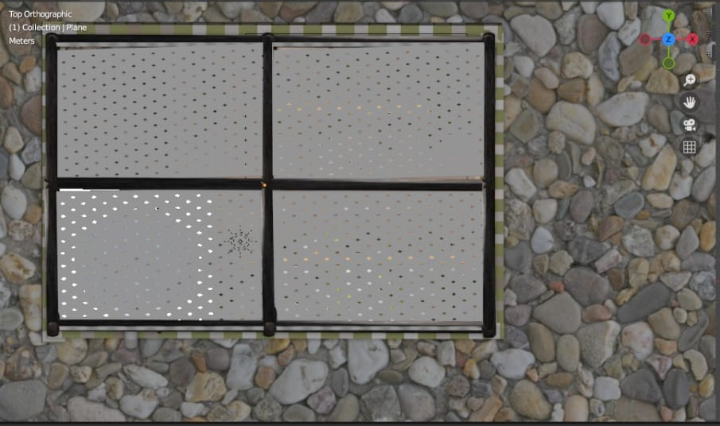

# Solar-Powered Smart Greenhouse Irrigation System: 3D Design Model

A 3D concept design of a self-contained, solar-powered greenhouse with an automated overhead irrigation system for small-scale crop production. The model was built in **Blender 3.0** as part of my Mechatronics Engineering studies at the Federal University Oye-Ekiti (February 2022).

## The problem

Small-scale farmers in Nigeria often depend on manual watering or unreliable grid power. Watering by hand wastes water and labour, and crops suffer during dry spells. This design explores a compact, off-grid greenhouse that waters crops automatically, using solar energy and a microcontroller-driven pump.

## System overview

| Subsystem | Design in the model |
|---|---|
| **Structure** | Steel-frame greenhouse with a gable roof (about 16° pitch) and ventilated, perforated wall panels for airflow |
| **Power** | Roof-mounted solar panel charging a battery bank |
| **Control** | Microcontroller housed with the battery in the equipment bay |
| **Water storage** | Elevated tank, giving gravity-assisted head to the pump inlet |
| **Pumping** | Electric pump controlled by the microcontroller |
| **Water distribution** | Overhead pipe manifold with downward spray nozzles above each crop row |
| **Growing area** | Two raised planting beds with a central walkway, modelled with maize |

## Key dimensions

| Feature | Dimension |
|---|---|
| Overall width (front) | 12 ft |
| Overall height to eaves | 7 ft |
| Roof rise | 1 ft |
| Roof rafter length | 6.64 ft |
| Door height | 5.5 ft |
| Planting area length | 8.2 ft |
| Crop row spacing / nozzle spacing | 1.31 ft |
| Central walkway width | 2.62 ft |
| Spray manifold span | 5.24 ft |

## How it is intended to work

1. The solar panel charges the battery during the day.
2. The microcontroller decides when to irrigate, for example on a timer or from soil-moisture readings.
3. When irrigation is needed, the microcontroller switches on the pump.
4. The pump draws water from the elevated tank and pushes it through the overhead manifold.
5. The nozzles, spaced to match the crop rows, spray water evenly over each bed.
6. The pump switches off once the watering cycle is complete.

## Views

| | |
|---|---|
|  Front elevation |  Rear elevation with solar panel |
|  Right elevation |  Left elevation with door |
|  Plan view with solar panel |  Plan view of roof |

Additional elevations are in the [`images`](images/) folder.

## Skills demonstrated

- 3D modelling and visualisation in Blender
- Mechatronic system design: integrating structure, power, sensing/control and actuation
- Solar power and off-grid system layout
- Irrigation layout: matching nozzle spacing to crop row spacing
- Dimensioned orthographic views (front, rear, side and plan)

## Future work

- Rebuild the structure as a parametric CAD model in SolidWorks, with detailed parts and drawings
- Design the control circuit (microcontroller, moisture sensor, relay and pump driver)
- Size the solar panel, battery and pump for a target water demand
- Build and test a small-scale physical prototype

## Author

**Abdulazeez Nasirudeen** - Mechatronics Engineer (B.Eng, Federal University Oye-Ekiti)

[LinkedIn](https://www.linkedin.com/in/abdulazeez-nasirudeen/) · [GitHub](https://github.com/Nasabdul1)
